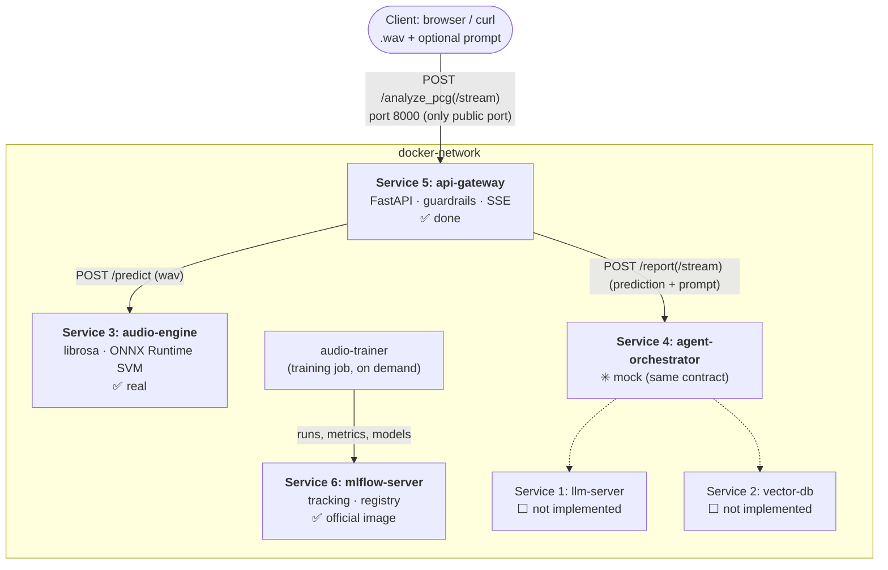
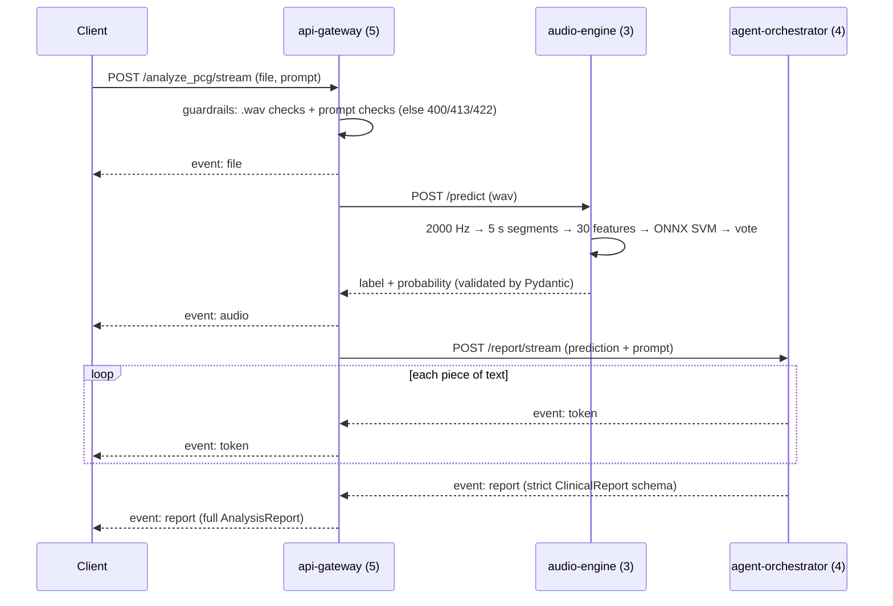

# CardioAgent-Ops

Containerised micro-service platform for heart sound (PCG) analysis.
Mini Projet Data Mining & Machine Learning: ENSIT, 3G Math (2026-2027).

A client uploads a heart sound recording (`.wav`) and an optional clinical context. The **api-gateway** checks
the inputs (guardrails), the **audio-engine** classifies the recording (normal / abnormal) with an SVM served by
ONNX Runtime, the **agent-orchestrator** writes a clinical report, and the gateway returns it as one validated
JSON report or streams it in real time (Server-Sent Events).

> **Scope.** The professor asked us to focus on **Service 5: api-gateway**. It is complete. We also built the
> real **Service 3: audio-engine** (data mining, SVM, MLflow, ONNX) and run the official **Service 6: mlflow-server**.
> **Service 4: agent-orchestrator** is a **mock** with the official name and the exact contract (JSON + SSE), so the
> real LangGraph service can replace it without changing the gateway. Services 1 (llm-server) and 2 (vector-db) are
> not implemented.

## Architecture



### One request, step by step



`POST /analyze_pcg` does the same in one call and returns only the final JSON report.

## Service 5: api-gateway

### Endpoints

| Method | URL | Description |
|---|---|---|
| GET | `/` | HTML upload page (shows the report text live) |
| GET | `/health` | `{"status": "ok", "service": "api-gateway"}` |
| POST | `/analyze_pcg` | form fields `file` = a `.wav`, `prompt` = optional clinical context → JSON report |
| POST | `/analyze_pcg/stream` | same inputs → **Server-Sent Events** stream |
| GET | `/docs` | Swagger UI (automatic FastAPI documentation) |

Errors: `400` bad/empty/invalid WAV or rejected prompt, `413` file > 20 MB, `422` no file,
`502` a service returned a bad answer, `503` a service is down, `504` a service is too slow.

Example answer of `POST /analyze_pcg`:

```json
{
  "file": {"filename": "a0001.wav", "size_bytes": 142708, "sample_rate": 2000, "duration_seconds": 35.666},
  "prompt": "Patient has chest pain",
  "audio": {"label": "abnormal", "probability_abnormal": 0.83, "model_name": "cardio-svm-rbf (ONNX)"},
  "report": {"summary": "...", "risk_level": "high", "recommendations": ["..."], "sources": ["ESC ..."], "audit_passed": true},
  "disclaimer": "Automatic analysis for education/research only. Not a medical diagnosis."
}
```

### Guardrails

**Inputs**, checked before anything reaches the AI services:

| Input | Rule | Answer |
|---|---|---|
| `file` | ends in `.wav`, not empty, ≤ 20 MB, valid WAV header, ≥ 1 audio frame | `400` / `413` |
| `prompt` (optional) | spaces and new lines collapsed; blank = no prompt | — |
| `prompt` | ≤ 500 characters | `400` |
| `prompt` | no prompt-injection phrases (`ignore previous instructions`, `system prompt`, `you are now`, …), case-insensitive | `400` |

**Outputs**: every answer of the other services is validated with Pydantic v2 (`api/schemas.py`) before it is
used or forwarded (`502` otherwise). The agents' report (`ClinicalReport`) is **strict**, because an LLM can
hallucinate: unknown fields are rejected (`extra="forbid"`), no type conversion (`strict=True`, `"true"` is not a
boolean), `risk_level` must be `low`/`medium`/`high`, and at least one recommendation and one ESC **source** are required.

The phrase list is a first line of defence, not a complete one: a real deployment adds a strict system prompt
in the agents and the output validation above.

### Streaming (SSE): `POST /analyze_pcg/stream`

The orchestrator exposes `POST /report/stream` (SSE). The gateway reads it with `httpx` (`client.stream` +
`aiter_lines`), validates every event and forwards it at once. The client receives, in order:

| Event | Data | When |
|---|---|---|
| `file` | `FileInfo` (name, size, sample rate, duration) | right after the input checks |
| `audio` | `AudioResult` (label, probability, model) | when audio-engine answers |
| `token` | `{"text": "..."}` | each piece of the report text, as the LLM writes it |
| `report` | the full `AnalysisReport` (same JSON as `/analyze_pcg`) | at the end |
| `error` | `{"status_code": 502/503/504, "detail": "..."}` | if a service fails during the stream |

Input errors are still normal HTTP `400/413/422`, because they are checked **before** the stream starts.
After that, the status `200` is already sent, so failures become an `error` event.

```bash
curl -X POST -F "file=@heart.wav" -F "prompt=Patient has chest pain" http://localhost:8000/analyze_pcg
curl -N -X POST -F "file=@heart.wav" http://localhost:8000/analyze_pcg/stream   # -N: print events as they arrive
```

## Service 3: audio-engine

### Data (notebook `01_eda_data_wrangling.ipynb`)

PASCAL Heart Sound Challenge + PhysioNet/CinC 2016, merged into `ourdataset/train/{normal,abnormal}`:
**3 784 recordings** (2 926 normal, 858 abnormal, 77 / 23 %).

### Pipeline (`audio_engine/features.py`)

1. **Load**: librosa, resampled to **2000 Hz** (heart sounds are below ~1000 Hz: Nyquist), mono, peak-normalised to [-1, 1].
2. **Segment**: non-overlapping **5 s** segments. The last piece is zero-padded if it lasts ≥ 2 s, dropped otherwise.
   A file shorter than 5 s becomes one padded segment. → **15 781 segments**.
3. **Features (30)**: 13 MFCC (n_fft=256, hop=64, n_mels=40), mean + std over time → 26, plus ZCR and RMS mean/std → 4.

### Training and model selection (`audio_engine/train_svm.py`)

`Pipeline(StandardScaler, SVC(class_weight="balanced"))`, kernels `linear` and `rbf`, validated with
`StratifiedGroupKFold(n_splits=3)` grouped by recording. Metrics per fold: accuracy, precision, **recall**, F1,
specificity, ROC-AUC. Positive class = abnormal.

| Kernel | Accuracy | Precision | **Recall** | F1 | Specificity | ROC-AUC |
|---|---|---|---|---|---|---|
| linear | 0.819 ± 0.017 | 0.581 ± 0.027 | 0.866 ± 0.023 | 0.695 ± 0.017 | 0.804 ± 0.026 | 0.889 ± 0.011 |
| **rbf** | **0.879 ± 0.009** | **0.688 ± 0.018** | **0.896 ± 0.013** | **0.778 ± 0.014** | **0.873 ± 0.010** | **0.951 ± 0.006** |

→ **rbf** has the best recall (the brief's selection rule) and wins on every metric, so it is registered as
`cardio-svm` in the MLflow Model Registry. Precision is lower because `class_weight="balanced"` pushes the SVM
toward "abnormal": more false alarms, fewer missed sick hearts.

### ONNX export (`audio_engine/export_onnx.py`)

The selected rbf pipeline is trained on all the segments with `probability=True` (Platt scaling) and converted
with `skl2onnx`, **scaler included**, to `audio_engine/cardio_model.onnx` (664 KB, 4 381 support vectors).
The export checks ONNX Runtime against scikit-learn: **label agreement 100 %, max probability difference 7·10⁻⁶**
(float32 vs float64). The file and the check are logged to MLflow (run `export-onnx-rbf`).

### Serving (`audio_engine/service.py`): `POST /predict`

Same preprocessing as training, one ONNX prediction per 5 s segment, then one answer per recording:
- `label`: **majority vote** of the segment labels, a tie counts as abnormal (favours recall);
- `probability_abnormal`: mean of the segment probabilities.

On the training files, the vote gives a file-level recall of 0.96 versus 0.86 for "mean probability ≥ 0.5"
(optimistic numbers, only used to compare the two rules). Known limit: near the boundary, label and probability
can disagree (e.g. `abnormal` with p = 0.32), because the label comes from the balanced decision function and the
probability from Platt scaling.

### MLflow (Service 6)

- Experiment **TP3-SVM**: parent runs `svm-linear` / `svm-rbf` with mean ± std of the metrics, the final model
  (signature + input example) and figures (`metrics_per_fold.png`, `roc_curves.png`, `kernel_comparison.png`);
  3 nested runs per kernel (`nested=True`) with the fold metrics, `confusion_matrix.png` and `roc_curve.png`;
  run `export-onnx-rbf` with `cardio_model.onnx`.
- **Models → cardio-svm**: the kernel with the best mean recall.

### Choices (for the oral)

- **Scaler inside the pipeline (no leakage).** Scaling the whole dataset before splitting would put the test
  fold's mean and std into training. In a `Pipeline`, `fit` only sees the training fold. SVMs need scaling
  because they are based on distances. The ONNX file also contains the scaler, so serving cannot forget it.
- **`class_weight="balanced"` (imbalance 77 / 23).** Without it, predicting "normal" almost always gives high
  accuracy. Balanced weights make a mistake on an abnormal segment cost about 3× more.
- **Grouped folds.** The segments of one recording come from the same patient and stethoscope, so they look alike.
  `StratifiedGroupKFold` keeps every file on one side (no optimistic score) and keeps the class ratio per fold.
- **Selecting by recall.** A false negative (a sick heart called "normal") sends the patient home: the worst
  error in screening. A false positive only costs an extra exam.
- **ONNX.** The serving image runs the model with ONNX Runtime: one portable file, same answers as scikit-learn,
  and the model is decoupled from the training code.
- **Only the gateway is exposed.** audio-engine has no `ports:`; it is reached through `docker-network`. Less attack
  surface and one place for input checks. Port 5000 of MLflow is published only to see the UI in development.

## Project structure

```
.
├── .github/workflows/mlops-ci-cd.yml   CI: tests + coverage gate, then build + smoke-test both images
├── api/                                Service 5: api-gateway (FastAPI)
│   ├── main.py                         endpoints, guardrails, SSE streaming
│   ├── schemas.py                      Pydantic v2 models (JSON contracts, strict agent report)
│   ├── clients.py                      httpx calls to audio-engine and agent-orchestrator (JSON + SSE)
│   └── static/index.html               upload page
├── audio_engine/                       Service 3: audio-engine
│   ├── features.py                     wav → 5 s segments → 30 features (cached in features.csv)
│   ├── train_svm.py                    SVM linear vs rbf, grouped CV, MLflow tracking + registry
│   ├── export_onnx.py                  final model → cardio_model.onnx (checked, logged to MLflow)
│   ├── service.py                      FastAPI POST /predict with ONNX Runtime
│   └── cardio_model.onnx               the exported model
├── mocks/orchestrator.py               Service 4 mock: POST /report (JSON) and /report/stream (SSE)
├── tests/
│   ├── test_api.py                     gateway: guardrails, flow, errors, SSE (pytest + HTTPX)
│   ├── test_audio.py                   features, metrics, grouped folds, training (MLflow mocked)
│   ├── test_audio_service.py           ONNX export + /predict service
│   ├── test_agents.py                  agents' output schema conformity (JSON + SSE)
│   └── conftest.py                     shared fixtures
├── docker/                             one multi-stage Dockerfile per image
├── notebooks/
│   ├── 01_eda_data_wrangling.ipynb     PASCAL + PhysioNet merge, durations, plots
│   └── 02_svm_mfcc_mlflow.ipynb        SVM experiments tracked in MLflow
├── docker-compose.yml                  all services on one docker-network
└── pyproject.toml / uv.lock            dependencies (uv), pinned versions
```

Not in git: `dataset/` and `ourdataset/` (raw and merged data, several GB), `mlruns/` and `mlflow.db`
(local MLflow runs), `.venv/`. Build `ourdataset/` with `notebooks/01_eda_data_wrangling.ipynb`.

## Run with Docker (recommended)

```bash
docker compose up --build -d          # gateway, audio-engine, orchestrator mock, mlflow-server
```

Open <http://localhost:8000> (upload page) or <http://localhost:5000> (MLflow UI), or use curl:

```bash
curl http://localhost:8000/health
curl -X POST -F "file=@ourdataset/train/abnormal/a0001.wav" -F "prompt=chest pain" http://localhost:8000/analyze_pcg
```

Train again inside Docker (logs to mlflow-server): `docker compose --profile training up audio-trainer`.
Stop everything: `docker compose down`.

## Run locally with uv (without Docker)

```bash
uv sync                                                        # Python 3.11 (see .python-version)
uv run uvicorn audio_engine.service:app --port 8001            # terminal 1: real audio-engine
uv run uvicorn mocks.orchestrator:app --port 8002              # terminal 2: orchestrator mock
uv run uvicorn api.main:app --reload --port 8000               # terminal 3: gateway
```

The gateway reads `AUDIO_ENGINE_URL`, `ORCHESTRATOR_URL` and `REQUEST_TIMEOUT` from the environment
(defaults: localhost). Training and export without Docker (logs to a local `mlflow.db`):

```bash
uv run python -m audio_engine.train_svm        # add --rebuild to extract the features again
uv run python -m audio_engine.export_onnx      # writes audio_engine/cardio_model.onnx
uv run mlflow ui --backend-store-uri sqlite:///mlflow.db
```

## Tests and coverage

```bash
uv run pytest --cov=api --cov=audio_engine --cov-report=term-missing
```

| File | Tests | What it covers |
|---|---|---|
| `test_api.py` | 40 | gateway: health, page, WAV + prompt guardrails, full flow, SSE events, 502/503/504 errors |
| `test_audio.py` | 15 | resampling, segmentation, features, metrics, grouped folds, training with MLflow mocked |
| `test_audio_service.py` | 11 | ONNX = scikit-learn, export, `/predict`, contract with the gateway, majority vote |
| `test_agents.py` | 45 | strict report schema rejects hallucinated output; orchestrator answers conform (JSON + SSE) |

**111 tests, 98 % coverage** of `api/` + `audio_engine/` (`main.py`, `service.py` 100 %), in about 25 s.
No network, no Docker and no dataset needed: the other services are replaced by `httpx.MockTransport`,
the models are trained on synthetic data and MLflow is mocked.

## CI/CD (`.github/workflows/mlops-ci-cd.yml`)

On every push and pull request:
1. **test**: `uv sync --locked`, pytest with coverage (fails under 80 %), upload `coverage.xml`.
2. **build** (only if tests pass), once per image with a matrix: build `api-gateway` and `audio-engine`,
   start the container, call `/health`.

## Status against the brief

| Brief | Status |
|---|---|
| Service 5 api-gateway: `/analyze_pcg`, `.wav` + prompt guardrails, SSE streaming, Pydantic | ✅ |
| Service 3 audio-engine: 2000 Hz, MFCC, MLflow, ONNX Runtime inference | ✅ with SVM (linear vs rbf); Decision Tree, CNN, ResNet, Transformer-CNN not done |
| Service 6 mlflow-server: tracking (`nested=True`), Model Registry | ✅ |
| Service 4 agent-orchestrator | ✳️ mock with the real contract (JSON + SSE) |
| Services 1 llm-server, 2 vector-db, LLM fine-tuning, RAG | ⬜ out of scope (focus on Service 5) |
| Tests `test_api.py`, `test_audio.py`, `test_agents.py` + coverage | ✅ 111 tests, 98 % |
| Multi-stage Dockerfiles, `docker-compose.yml`, `docker-network` | ✅ |
| GitHub Actions `mlops-ci-cd.yml` | ✅ |
