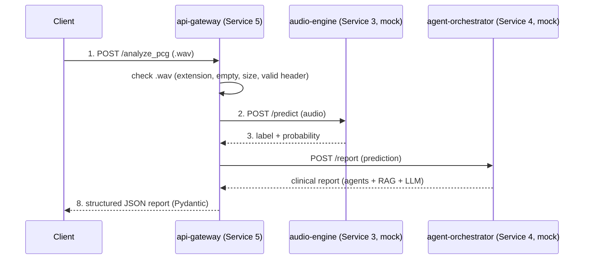

# CardioAgent-Ops — Service 5: api-gateway

Mini Projet Data Mining & Machine Learning — ENSIT, 3G Math (2026-2027).

The **api-gateway** is the single entry point of the platform. It receives a heart sound recording
(`.wav`, PCG), sends it to the **audio-engine** (ML prediction), sends the prediction to the
**agent-orchestrator** (clinical report written by the AI agents), and returns one structured JSON report.

> The professor asked us to focus on Service 5. Services 3 and 4 are replaced by small **mock** services
> (`mocks/`) that return fake answers with the same JSON format. They use the official service names,
> so the real services can replace them without changing the gateway code.

## Flow



## Endpoints

| Method | URL | Description |
|---|---|---|
| GET | `/` | HTML upload page |
| GET | `/health` | `{"status": "ok", "service": "api-gateway"}` |
| POST | `/analyze_pcg` | form fields `file` = a `.wav` file, `prompt` = optional clinical context → JSON report |
| POST | `/analyze_pcg/stream` | same inputs → **Server-Sent Events** stream (used by the upload page) |
| GET | `/docs` | Swagger UI (automatic FastAPI documentation) |

Errors: `400` bad/empty/invalid WAV or rejected prompt, `413` file > 20 MB, `422` no file,
`502` a service returned a bad answer, `503` a service is down, `504` a service is too slow.

### Guardrails (input checks before anything reaches the AI services)

| Input | Rule | Answer |
|---|---|---|
| `file` | must end in `.wav`, not be empty, be ≤ 20 MB, have a valid WAV header and ≥ 1 audio frame | `400` / `413` |
| `prompt` (optional) | spaces and new lines collapsed; blank = no prompt | — |
| `prompt` | ≤ 500 characters | `400` |
| `prompt` | no prompt-injection phrases (`ignore previous instructions`, `system prompt`, `you are now`, …), case-insensitive | `400` |

The cleaned prompt is forwarded to the agent-orchestrator and echoed in the report (`"prompt"` field).
The gateway also validates every answer of the other services with Pydantic (`502` if the format is wrong).

```bash
curl -X POST -F "file=@heart.wav" -F "prompt=Patient has chest pain" http://localhost:8000/analyze_pcg
```

### Streaming (SSE): `POST /analyze_pcg/stream`

The brief asks the gateway to stream the agents' answer to the client in real time. The orchestrator exposes
`POST /report/stream` (SSE); the gateway reads it with `httpx` (`client.stream` + `aiter_lines`), validates every
event with Pydantic and forwards it at once. The client receives, in order:

| Event | Data | When |
|---|---|---|
| `file` | `FileInfo` (name, size, sample rate, duration) | right after the input checks |
| `audio` | `AudioResult` (label, probability, model) | when audio-engine answers |
| `token` | `{"text": "..."}` | each piece of the report text, as the LLM writes it |
| `report` | the full `AnalysisReport` (same JSON as `/analyze_pcg`) | at the end |
| `error` | `{"status_code": 502/503/504, "detail": "..."}` | if a service fails during the stream |

Input errors (bad WAV, rejected prompt) are still normal HTTP `400/413/422`, because they are checked **before**
the stream starts. After that the HTTP status `200` is already sent, so failures become an `error` event.

```bash
curl -N -X POST -F "file=@heart.wav" http://localhost:8000/analyze_pcg/stream   # -N: print events as they arrive
```

## Project structure

```
.
├── .github/workflows/mlops-ci-cd.yml   CI: tests + coverage gate, then Docker build + smoke test
├── api/                                Service 5: api-gateway (FastAPI)
│   ├── main.py                         endpoints + WAV checks (guardrails)
│   ├── schemas.py                      Pydantic v2 models (JSON contract)
│   ├── clients.py                      httpx calls to audio-engine and agent-orchestrator
│   └── static/index.html               upload page
├── audio_engine/                       Service 3: audio-engine (features + SVM training, MLflow)
│   ├── features.py
│   └── train_svm.py
├── mocks/                              fake audio-engine and agent-orchestrator (same JSON contract)
├── tests/
│   ├── test_api.py                     gateway integration tests (pytest + HTTPX)
│   └── test_audio.py                   audio pipeline unit tests
├── docker/                             one Dockerfile per image (multi-stage)
├── notebooks/
│   ├── 01_eda_data_wrangling.ipynb     PASCAL + PhysioNet merge, durations, plots
│   └── 02_svm_mfcc_mlflow.ipynb        SVM experiments tracked in MLflow
├── docker-compose.yml                  all services on one docker-network
├── pyproject.toml / uv.lock            dependencies (uv), pinned versions
└── README.md
```

Not in git: `dataset/` and `ourdataset/` (raw and merged data, several GB), `mlruns/` and `mlflow.db`
(local MLflow runs), `.venv/`. Build `ourdataset/` with `notebooks/01_eda_data_wrangling.ipynb`.

## Run with Docker (recommended)

```bash
docker compose up --build
```

Then open <http://localhost:8000> and upload a `.wav`, or use curl:

```bash
curl http://localhost:8000/health
curl -X POST -F "file=@ourdataset/train/normal/101_1305030823364_B.wav" http://localhost:8000/analyze_pcg
```

Stop everything with `docker compose down`.

## Run locally with uv (without Docker)

```bash
uv sync                                                        # install everything (Python 3.11, see .python-version)
uv run uvicorn mocks.audio_engine:app --port 8001              # terminal 1
uv run uvicorn mocks.orchestrator:app --port 8002              # terminal 2
uv run uvicorn api.main:app --reload --port 8000               # terminal 3
```

The gateway reads the service URLs from environment variables
(`AUDIO_ENGINE_URL`, `ORCHESTRATOR_URL`, `REQUEST_TIMEOUT`); the defaults point to localhost.

## Tests and coverage

```bash
uv run pytest --cov=api --cov=audio_engine --cov-report=term-missing
```

55 tests (40 gateway in `test_api.py` + 15 audio in `test_audio.py`), **98 % coverage** of `api/` + `audio_engine/` (`main.py` 100 %). The other services are replaced by an `httpx.MockTransport`,
so the tests need no network and no Docker. They cover: health, HTML page, file checks,
the full flow, service down (503), timeout (504), HTTP error / invalid JSON / wrong format (502).

## CI/CD

`.github/workflows/mlops-ci-cd.yml` runs on every push and pull request:
1. **test**: install with uv, run pytest with coverage of `api/` and `audio_engine/` (fails under 80 %), upload `coverage.xml`.
2. **build** (only if tests pass): build `docker/api-gateway.Dockerfile`, start it and check `/health`.

## TP3 — SVM + MLflow

First real version of **Service 3 (audio-engine)**, as a training job, and **Service 6 (mlflow-server)**.
The mock `audio-engine` stays in place for the gateway. The training job is a separate service, `audio-trainer`.

```
audio_engine/features.py        wav -> 5 s segments -> 30 features per segment (cached in features.csv)
audio_engine/train_svm.py       SVM linear vs rbf, 3 grouped folds, MLflow tracking + model registry
docker/audio-engine.Dockerfile  multi-stage image (python:3.11-slim + libsndfile1)
tests/test_audio.py             synthetic wav files, metrics, grouped folds, MLflow mocked
```

### Pipeline

1. **Load**: librosa, resampled to **2000 Hz**, mono, peak-normalised to [-1, 1].
2. **Segment**: non-overlapping **5 s** segments. The last piece is zero-padded if it lasts at least 2 s and dropped otherwise.
   A file shorter than 5 s becomes one padded segment.
3. **Features (30)**: 13 MFCC (n_fft=256, hop=64, n_mels=40), mean + std over time → 26,
   plus ZCR mean/std and RMS mean/std → 4.
4. **Model**: `Pipeline(StandardScaler, SVC(class_weight="balanced"))` with two kernels:
   `linear` (C=1) and `rbf` (C=1, gamma="scale").
5. **Validation**: `StratifiedGroupKFold(n_splits=3, shuffle=True, random_state=42)`, grouped by file.
6. **Metrics per fold**: accuracy, precision, recall, F1, specificity, ROC-AUC (from `decision_function`).
   The positive class is 1 = abnormal.

### Run it

```bash
docker compose up --build          # starts the gateway, the mocks, mlflow-server and audio-trainer
```

`audio-trainer` waits until `mlflow-server` is healthy, extracts the features (only the first time,
then it reads `ourdataset/cache/features.csv`), trains, then stops. Open <http://localhost:5000>.

Without Docker (logs to a local `mlflow.db`):

```bash
uv run python -m audio_engine.train_svm            # add --rebuild to extract the features again
uv run mlflow ui --backend-store-uri sqlite:///mlflow.db
```

### What you see in MLflow

- Experiment **TP3-SVM**, with 2 parent runs: `svm-linear` and `svm-rbf`.
  Each has its params, `<metric>_mean` / `<metric>_std` over the 3 folds, and the final model
  (trained on all the data, with its signature and an input example).
- Under each parent, 3 nested runs `svm-<kernel>-fold<k>` with the fold number, the train/test sizes,
  the 6 metrics, `confusion_matrix.png` and `roc_curve.png`.
- The metrics are also saved **as graphics** in the **Artifacts** tab of each parent run: `metrics_per_fold.png`
  (bars = mean ± std, dots = each fold), `roc_curves.png` (3 folds) and `kernel_comparison.png` (linear vs rbf).
  The **Chart** tab shows `fold_<metric>` as a curve over folds 1 → 2 → 3.
- **Models → cardio-svm**: the kernel with the best mean recall.

### Results (3 folds, mean ± std)

15 781 segments from 3 784 files (2 926 normal, 858 abnormal). Positive class = abnormal.

| Kernel | Accuracy | Precision | **Recall** | F1 | Specificity | ROC-AUC |
|---|---|---|---|---|---|---|
| linear | 0.819 ± 0.017 | 0.581 ± 0.027 | 0.866 ± 0.023 | 0.695 ± 0.017 | 0.804 ± 0.026 | 0.889 ± 0.011 |
| **rbf** | **0.879 ± 0.009** | **0.688 ± 0.018** | **0.896 ± 0.013** | **0.778 ± 0.014** | **0.873 ± 0.010** | **0.951 ± 0.006** |

→ **rbf** wins on recall and on every other metric too, so it is registered as `cardio-svm`.
It shows the kernel trick at work: in the 30-feature space the two classes are not linearly separable, and the
Gaussian kernel separates them better. The precision is lower (≈ 0.69) because `class_weight="balanced"` pushes the
SVM toward "abnormal". That is the trade-off we accept: more false alarms, fewer missed sick hearts.

### Choices (for the oral)

- **Scaler inside the pipeline (no leakage).** If we scaled the whole dataset before splitting, the mean and std
  would include the test fold, so the test data would leak into training. In a `Pipeline`, `fit` only sees the
  training fold. SVMs need scaling because they are based on distances.
- **`class_weight="balanced"` (imbalance 77 / 23).** Without it, the SVM can reach high accuracy by predicting
  "normal" almost all the time. Balanced weights make a mistake on an abnormal segment cost about 3× more.
- **Grouped folds (segments of the same file).** The segments of one recording come from the same patient
  and the same stethoscope, so they look alike. If some went to train and others to test, the model would
  recognise the recording and the score would be too optimistic. `StratifiedGroupKFold` keeps every file on
  one side and keeps the class ratio in each fold.
- **Selecting by recall.** In medical screening, a false negative (a sick heart called "normal") is the worst
  error, because the patient is sent home. A false positive only costs an extra exam. So the registered model
  is the kernel with the best recall on the abnormal class, as the brief asks.
- **audio-engine is not exposed.** It has no `ports:`. Only the gateway (8000) is the entry point and
  `audio-engine` is reached through `docker-network`. This means less attack surface and one place for input
  checks. Port 5000 of MLflow is published only for development, to see the UI.
